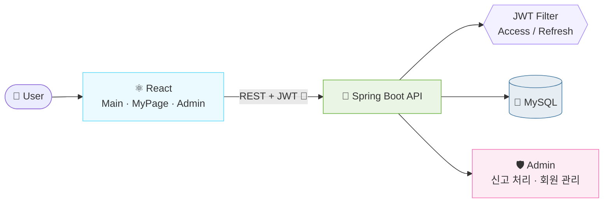

<!-- 다크/라이트 모드에 따라 자동으로 바뀌는 애니메이션 헤더 (assets/ 안의 직접 만든 SVG) -->
<picture>
  <source media="(prefers-color-scheme: dark)" srcset="./assets/header-dark.svg">
  <source media="(prefers-color-scheme: light)" srcset="./assets/header-light.svg">
  
</picture>

  

---

### 🧩 Dev in — Architecture

> 개발하다 막힐 때, 묻고 답하는 개발자 Q&A 커뮤니티 · 팀장 / 메인 · 관리자 페이지 담당

<a href="https://github.com/likelion-backendschool-11st/basic-project-3team">→ repository</a>

---

### 📅 Contribution in 3D

<!-- GitHub Actions(lowlighter/metrics)가 매일 자동 생성 -->

  

<b>🐍 more — snake eating my contributions</b>

 

<!-- GitHub Actions(Platane/snk)가 매일 자동 생성 → output 브랜치 -->
<picture>
  <source media="(prefers-color-scheme: dark)" srcset="https://raw.githubusercontent.com/innoo47/innoo47/output/github-snake-dark.svg">
  <source media="(prefers-color-scheme: light)" srcset="https://raw.githubusercontent.com/innoo47/innoo47/output/github-snake.svg">
  
</picture>

<b>🎮 off-duty</b>

 

`FC Online` · `League of Legends` · `PUBG` · `MapleStory`

